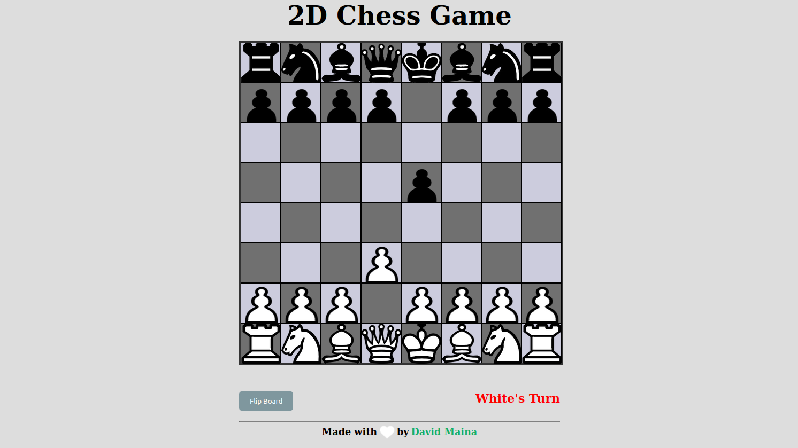

## JS 2D Chess Game

This is a complete well automated multi-player chess game implemented in HTML5, CSS, and JavaScript. 


_The game in action._

## Features

- Responsive design: the board keeps a square 8×8 grid on narrow phone screens, captured-piece trays move below it, and essential controls wrap without requiring horizontal scrolling; mobile buttons and selectors have 44px minimum targets with extra spacing
- Flip Board control to change viewpoints without changing square or piece identities
- Algebraic rank/file coordinates and screen-reader names remain attached to the same squares when the board is flipped
- Accessible chess clock with Bullet/Blitz/Rapid presets, active-side readouts, and start/pause/resume controls
- Optional, muted-by-default move, capture, check, and game-end cues with a saved sound preference
- Keyboard board navigation with arrow keys, Enter/Space activation, Escape cancellation, and visible focus
- On touch screens, tap a current-side piece to show legal moves, tap a legal destination to move, or tap the selected piece again to cancel
- Portrait screens keep the clock and move history in a readable vertical flow; short landscape screens place status beside the board and clock beside history
- Board cells expose their algebraic coordinate and current piece; piece images receive meaningful alternative text
- Reduced-motion, higher-contrast, and forced-colors modes respect operating-system accessibility settings
- Distinguishes the selected piece from its legal destinations and announces the destination squares to screen readers
- Uses separate markers and spoken labels for quiet moves, captures, en passant, and castling
- Highlights the previous move's origin and destination; castling marks both king and rook squares, with checked-king styling kept distinct
- Moves validations
- Animated display of checkmate and winner
- Undo and redo controls with Ctrl/Cmd+Z, Ctrl/Cmd+Y, and Ctrl/Cmd+Shift+Z shortcuts
- New Game action that confirms before discarding a game with recorded progress
- Resignation with confirmation, an announced result, locked terminal controls, and a restart action
- Automatically saves stable in-progress games after completed moves; after refresh, choose Resume Saved Game or Start New Game, and clear the saved copy while continuing a resumed game; corrupt or unsupported snapshots are discarded with an accessible notice, while blocked storage never prevents play

## Installation

1. Clone the repository: `git clone https://github.com/davymaish/2d-chess-game.git`
2. Open the `index.html` file in your preferred web browser.

## How to Play

1. Open the game in your web browser.
2. Click a piece to see the selected square and legal destinations highlighted differently; capture and special-move targets use their own markers, screen readers announce each square and move type, and the previous move remains highlighted.
3. Use Flip Board to view the same position from the opposite side; the coordinates, square names, selection, and legal-move markers stay associated with their original squares.
4. Select a square and the piece will move to that square; keyboard users can move focus with the arrow keys, press Enter or Space to select a piece or destination, and press Escape to cancel a selection.
5. Use the Undo and Redo buttons, or Ctrl/Cmd+Z and Ctrl/Cmd+Y (Ctrl/Cmd+Shift+Z also redoes), to navigate recent moves.
6. Choose New Game to reset the board; confirm first if the current game has progress.
7. Choose Resign and confirm to end the game; the result screen offers a new-game action.
8. The game displays the winner when the king is checked.

## Keyboard and sound preferences

Tab to the chessboard to focus its first square. Use the arrow keys to move between squares; navigation reverses with the flipped board. Press Enter or Space to select a current-side piece or play a highlighted legal move, and Escape to cancel the current selection. Undo uses Ctrl/Cmd+Z; redo uses Ctrl/Cmd+Y or Ctrl/Cmd+Shift+Z. Other controls, including Flip Board, New Game, Resign, promotion choices, and the chess clock, are standard keyboard-focusable buttons or form controls.

The “Move and capture sounds” checkbox is off by default and saves the preference in browser storage when permitted. When enabled, move, capture, check, and game-end cues are brief and quiet; they are skipped when the browser does not support Web Audio. Reduced animation, higher contrast, and forced-color adjustments follow the corresponding operating-system/browser accessibility preferences.

## Running Tests

The movement regression tests use Node.js's built-in test runner and require no additional dependencies. With Node.js 18 or newer installed, run:

```sh
npm test
```

Browser checks run the page in Chromium at representative phone and tablet sizes, verifying square board geometry, panel placement, and horizontal overflow. They also exercise move autosave, the explicit resume prompt, continued play, start-new and clear-save actions, promoted-piece restoration, saved-clock restoration, corrupt/outdated save recovery, and non-blocking autosave failure. They require Python 3, Playwright, and Chromium; install Playwright and its browser with `python3 -m pip install playwright` and `python3 -m playwright install chromium`, then run:

```sh
npm run test:responsive
```

To use an existing Chromium installation instead of Playwright's downloaded browser, set `CHROMIUM_EXECUTABLE_PATH` to its executable path.

## Local save format

`src/game-save.js` defines a version-1 JSON format for stable, in-progress games. It validates piece identities and positions, turn, castling flags, en-passant state, move history, half-move count, repetition counts, last-move squares, and optional clock state; malformed, oversized, unsupported-version, finished, or transitional saves are rejected. `src/game-persistence.js` stores the validated snapshot in browser storage after completed moves and reports whether a save is available, missing, corrupt, outdated, or inaccessible. Corrupt and unsupported snapshots are removed when possible and announced; inaccessible storage or quota errors produce a polite warning without interrupting the current game. Resuming restores the board, side to move, history, piece rights, repetition state, and optional clock. Clear Saved Game removes the stored copy without ending the current game; subsequent moves are saved again when storage is available.

## FEN export

`Game.toFEN()` serializes the current board as Forsyth–Edwards Notation. It exports piece placement, active color, castling rights that remain available on the original king/rook squares, the en-passant target, and the half-move and full-move counters. The standalone `serializeGameToFEN(game)` helper can also be used by tools and tests; invalid board state or counters are rejected instead of producing malformed FEN.

## Chess clock model

`src/chess-clock.js` provides the reusable `ChessClock` model. It tracks separate white and black time banks, switches the active side, supports start/pause/resume, and reports updates or flag fall through callbacks. `getChessClockPreset()` provides common Bullet 1+0, Blitz 3+2/5+0, and Rapid 10+0/15+10 configurations. A configurable increment is credited to the side that completes a move. `Game.attachClock(clock)` starts a clock for the current side, and completed moves select the next side explicitly; nested castling rook movement does not create a second switch. Flag fall ends the game as a win only when the opponent has mating material; otherwise it is a draw. The page includes accessible clock readouts and preset/start/pause/resume controls. Tests inject a controllable time source and timer scheduler to cover elapsed-time, pause/resume, side-switch, increment, timeout-at-pause, backward-clock, and stop edge cases without waiting for real time.

Move and capture sounds are off by default. Use the “Move and capture sounds” checkbox to enable distinct short tones for moves, captures, check, and game-end results; the setting is saved in browser storage when available. Status cues are dispatched only for check-only positions and the single shared terminal-result path. The cues use the Web Audio API and fail silently when audio is unavailable.

## Contributing

Contributions are welcome! If you find any issues or have ideas for improvements, please open an issue or submit a pull request.

## License

This project is licensed under the [MIT License](LICENSE).

## Credits and Acknowledgements

The chess pieces images are downloaded from [Pixabay](https://pixabay.com/).

## Contact

For any inquiries or feedback, feel free to contact me via:

- Website: [davymaish.github.io](https://davymaish.github.io)
- Email: [davymaish6@gmail.com](mailto:davymaish6@gmail.com)
